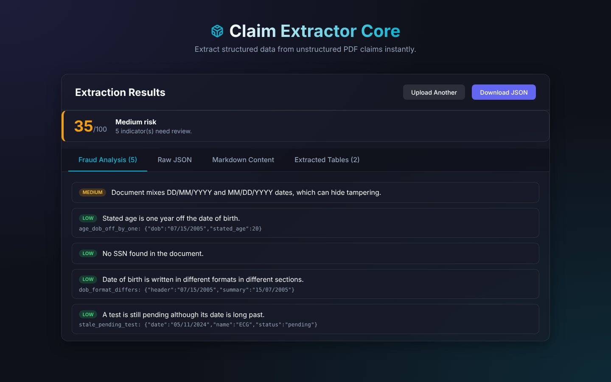
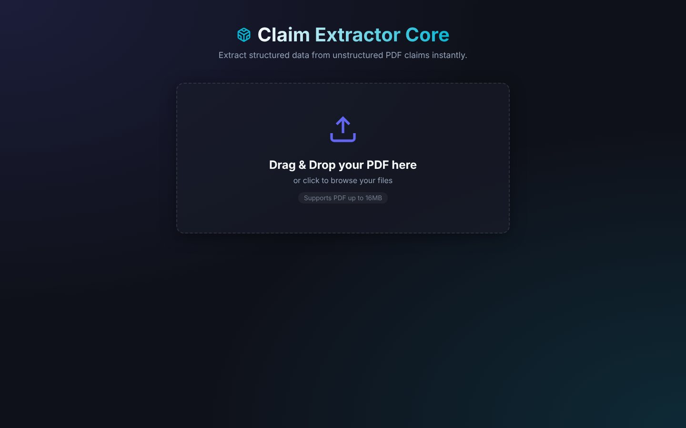
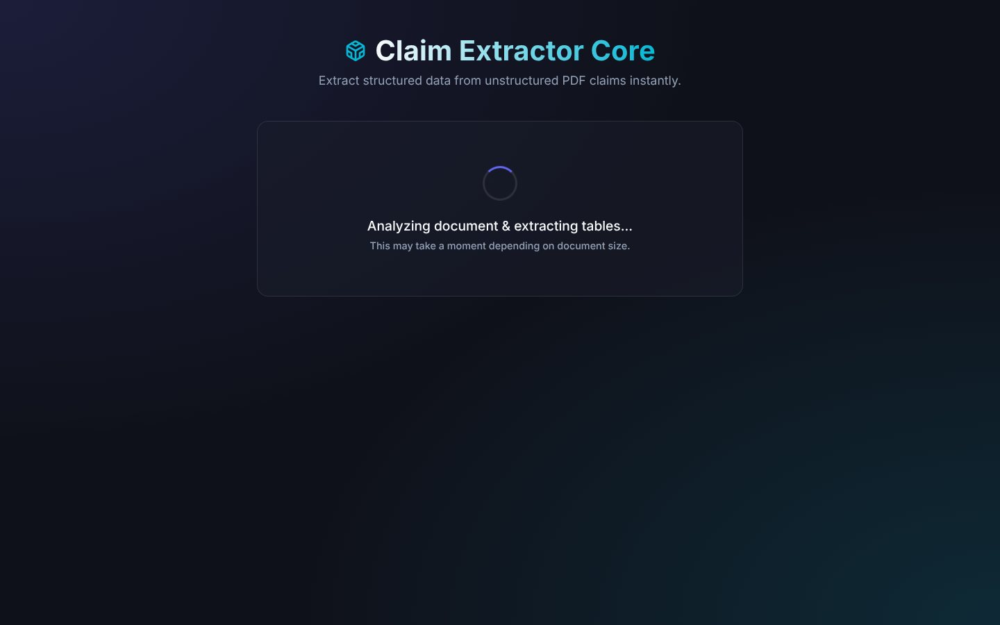
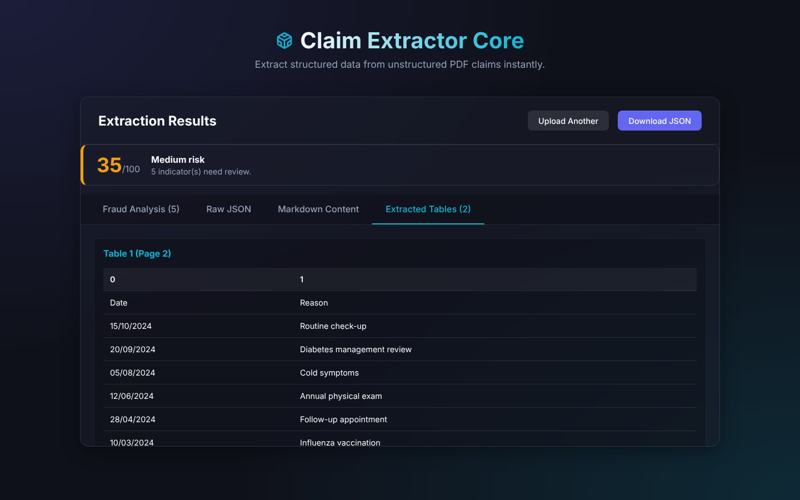
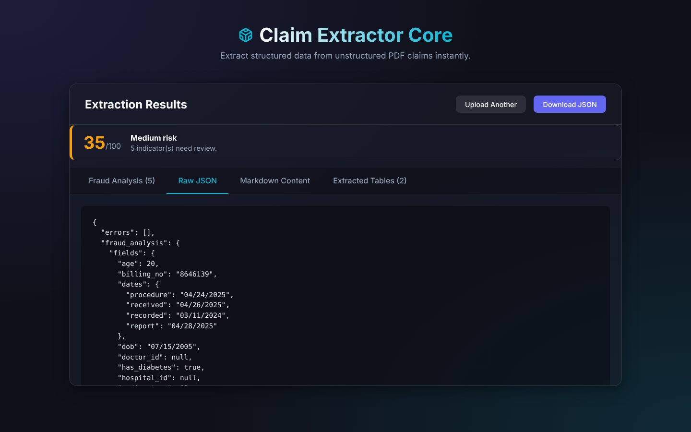
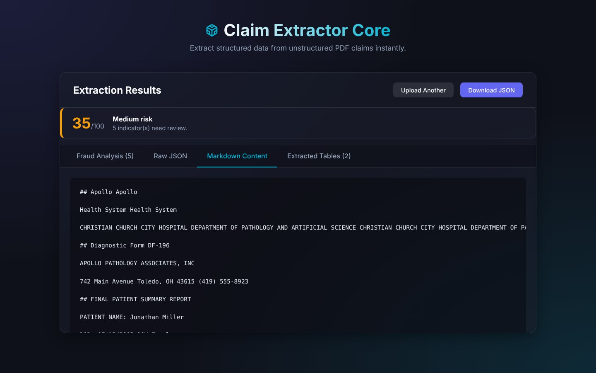

<div align="center">

# SCAM and Fraud Detection

**Extracts structured data from patient-claim PDFs and scores each document for fraud / tampering risk with an explainable, rule-based engine.**




</div>

## Screenshots

> Real captures of the running web UI analysing `PDF_Original/Hard/PDF_Deid_Deidentification_Hard_0.pdf` (de-identified sample) with RapidOCR.

| Upload | Processing (OCR + table extraction) |
|:---:|:---:|
|  |  |
| **Extracted tables** | **Raw JSON (with `fraud_analysis`)** |
|  |  |

<details>
<summary>Markdown view of the extracted document</summary>

</details>

## How it works

```
PDF ──► claim_parser.py ──────────────────────────► fraud_detector.py ──────────────► JSON + web UI
        Docling layout + OCR (Surya / RapidOCR)       extract key fields, run           risk_score 0–100
        → Markdown, tables, JSON                       consistency rules                 risk_level + flags
```

1. `claim_parser.py` – OCR + table extraction → Markdown, tables, JSON.
2. `fraud_detector.py` – extracts key fields and runs consistency rules, returning
   `risk_score` (0-100), `risk_level` (`low` < 20 ≤ `medium` < 50 ≤ `high`) and
   a list of explained `flags` (included in the JSON as `fraud_analysis`).
3. `app.py` – Flask web UI (`/`) and API (`POST /api/upload`, `GET /health`).

## Rules implemented

| Area | Checks |
|------|--------|
| Identity | name / DOB / age / sex differ between header and summary; OCR-level name variance (low) |
| Age & DOB | age vs DOB gap (1 yr = low, 2–9 = medium, ≥10 = high); invalid or future DOB |
| SSN & IDs | never-issued SSN ranges, placeholder SSNs, malformed SSN / hospital / doctor IDs |
| Dates | future dates, dates before birth, procedure → received → report ordering, stale reports, mixed DD/MM vs MM/DD formats |
| Visits & tests | duplicate / future / pre-birth visits, "Done" tests dated in the future, long-stale "Pending" tests |
| Vitals | implausible heart rate, respiratory rate, temperature, SpO₂, blood pressure |
| Clinical | diabetes medication without a diagnosis, duplicate medications |
| Completeness | missing core fields, no identifiers, no extractable text |

Each flag has a severity weight (high 30, medium 15, low 5; capped at 100).

## Run

Docker (needed for Surya OCR, see [`DOCKER.md`](DOCKER.md)):

```bash
docker compose build
docker compose up          # web UI on http://localhost:5000
```

Local (falls back to RapidOCR if `docling-surya` is missing):

```bash
pip install -r requirements.txt
python app.py                                   # web UI on http://localhost:5000
INPUT_PDF=PDF_Original/Easy/PDF_Deid_Deidentification_0.pdf python claim_parser.py   # CLI
```

The first run downloads the Docling layout and OCR models from Hugging Face; later runs use the local cache.

### API

```bash
curl -F "file=@PDF_Original/Hard/PDF_Deid_Deidentification_Hard_0.pdf" http://localhost:5000/api/upload
```

Returns `markdown`, `tables`, `table_count`, `fraud_analysis` (`risk_score`, `risk_level`, `flags`), `warnings` and `errors`.

## Sample data

`PDF_Original/` holds 50 de-identified claim PDFs in three difficulty levels: `Easy/` (30), `Medium/` (10) and `Hard/` (10). Example output: [`outputs/`](outputs).

## Tests

```bash
pytest tests
```

The detector is stdlib-only, so tests run without Docling or OCR models.

## Project structure

```
app.py              Flask web UI + API
claim_parser.py     Docling/OCR extraction → Markdown, tables, JSON
fraud_detector.py   rule engine → risk score, level, flags
templates/, static/ web UI
tests/              detector unit tests
PDF_Original/       de-identified sample claims
outputs/            example extraction output
Dockerfile, docker-compose.yml, DOCKER.md
```

> The detector flags documents for **human review**; it does not prove fraud.

## License

MIT, see [LICENSE](LICENSE).
